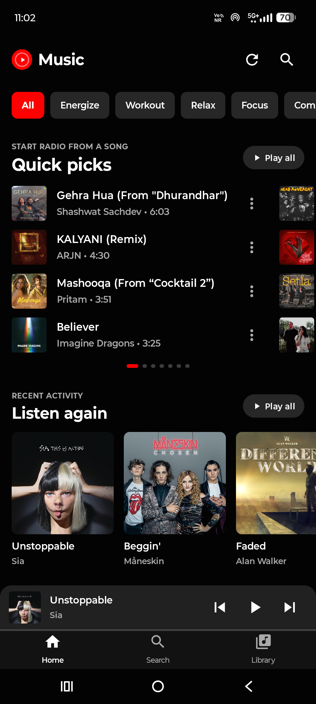
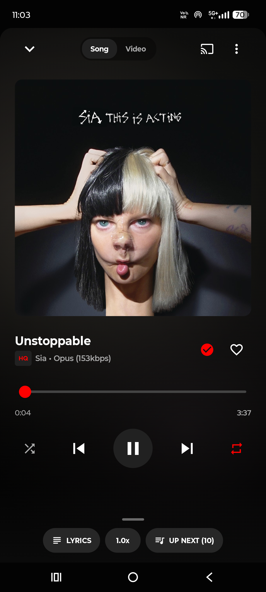
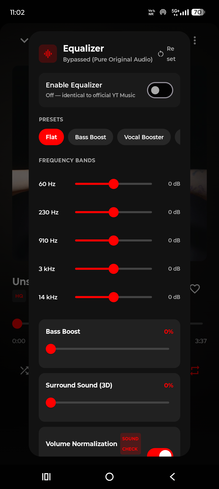
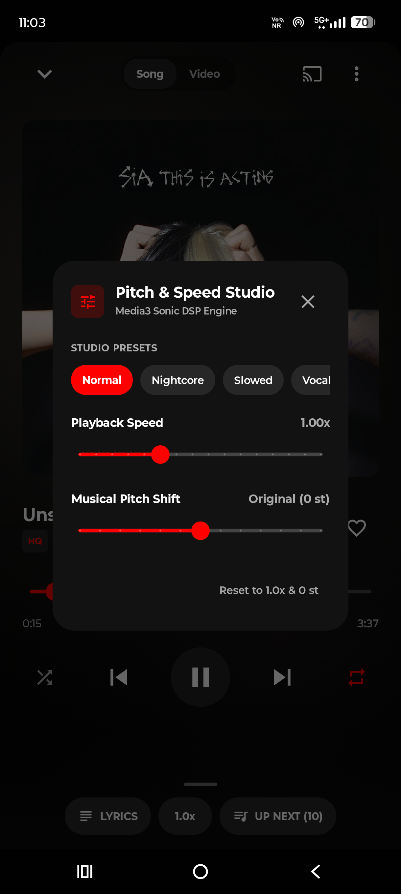
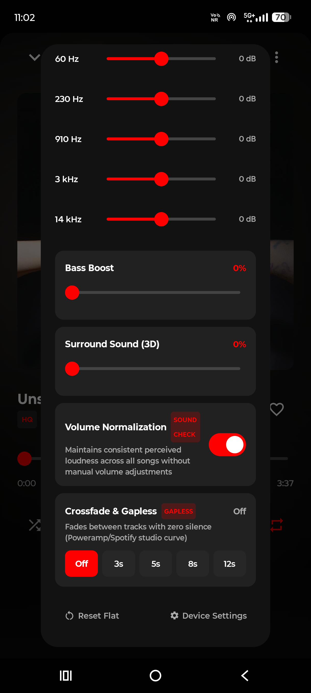
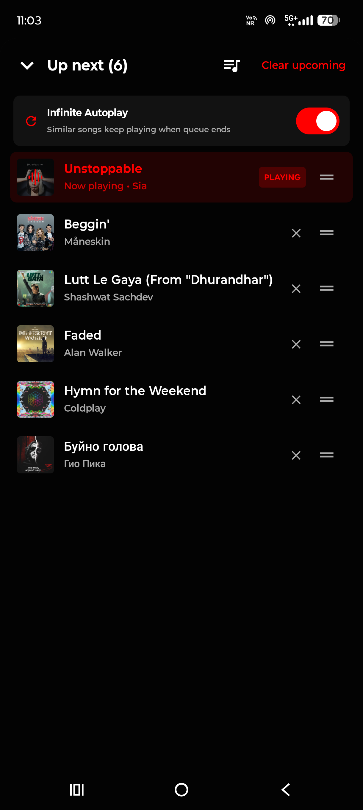
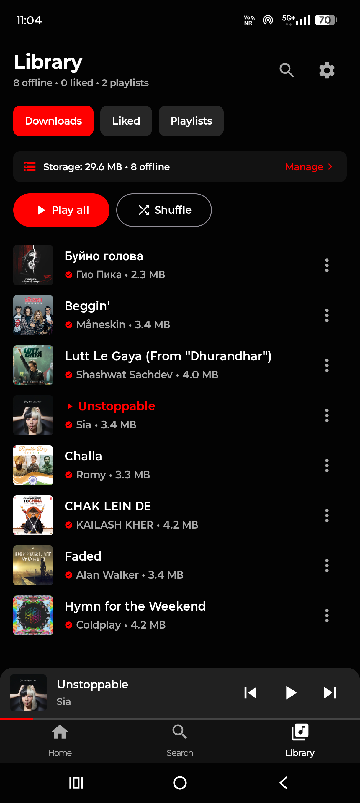
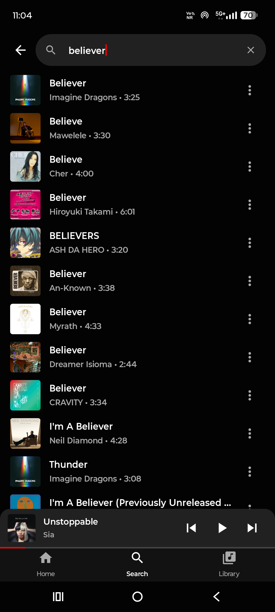
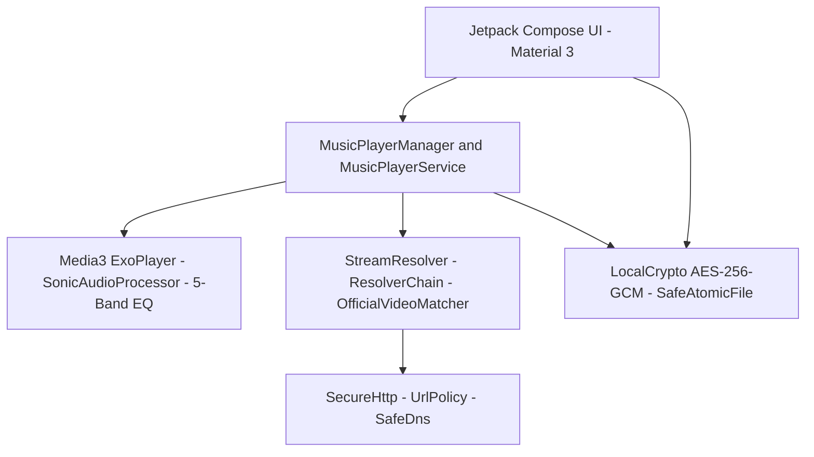
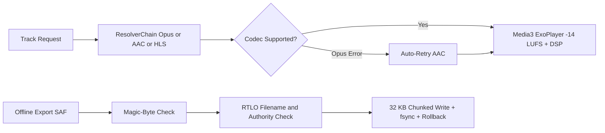

# Compose Media3 Audio & DSP Player

<p align="left">
  
  
  
  
  
  
</p>

An ultra-lightweight (~2.2 MB), privacy-hardened Android audio streaming and DSP player built with **Kotlin 2.0.0**, **Jetpack Compose (Material 3)**, and **AndroidX Media3 (ExoPlayer)**. Engineered with hardware-backed Keystore AEAD encryption, strict SSRF/DNS-rebinding defenses, zero telemetry, synchronized LRC lyrics, and real-time audio DSP controls.

---

## Screenshots

| Home & Quick Picks | Now Playing (`Opus 153 kbps`) | 5-Band Equalizer | Pitch & Speed Studio |
| :---: | :---: | :---: | :---: |
|  |  |  |  |

| Normalization & Crossfade | Drag-and-Drop Queue | Offline Library | Instant Search |
| :---: | :---: | :---: | :---: |
|  |  |  |  |

---

## System & Security Architecture



---

## At-a-Glance Highlights

| Area | What's Implemented | Key Classes |
| :--- | :--- | :--- |
| **Encryption at Rest** | Hardware-backed Keystore `AES-256-GCM` with per-store `AAD` binding & atomic writes | `LocalCrypto`, `SafeAtomicFile` |
| **Network Hardening** | Strict `UrlPolicy` allowlists + `SafeDns` blocking private/loopback/CGNAT/IPv6-mapped IPs | `SecureHttp`, `UrlPolicy`, `SafeDns` |
| **IPC & Config Trust** | MediaSession caller verification + Ed25519-signed config updates with replay protection | `PackageValidator`, `DiagnosticSanitizer` |
| **Audio DSP Studio** | 5-band EQ (`60Hz`–`14kHz`), Bass Boost, 3D Virtualizer, Pitch (`±6 st`) & Speed (`0.5x`–`2.0x`) | `EqualizerSheet`, `PitchSpeedStudioDialog` |
| **Playback & Lyrics** | Decoupled scrubbing, LRC karaoke lyrics, fade transitions, sleep timer, MediaRouter2 output switcher | `LyricsPanel`, `SleepTimerSheet` |
| **Offline & SAF Export** | Zero-permission `CreateDocument` export with 6-layer magic-byte & sandbox validation | `DownloadManager` |
| **Video Parity Mode** | Strict official-video matching (`H.264` > `VP9` > `AV1`) paired with Opus 160 kbps audio | `OfficialVideoMatcher`, `VideoCodecPolicy` |

---

## Stream Resolution & Secure Export Pipelines



---

## Deep Dive (Click to Expand)

<details>
<summary><strong>1. Security & Privacy Architecture (6 Defense Layers)</strong></summary>

- **Keystore AES-256-GCM AEAD Storage:** Playlists, liked tracks, listening history, and player state are encrypted at rest with unique Additional Authenticated Data (`AAD`) to prevent cross-store splicing, backed by atomic writes (`SafeAtomicFile`).
- **SSRF & DNS Rebinding Defense (`SafeDns`):** Resolves IPs before connecting and drops loopback (`127.0.0.0/8`, `::1`), private LAN (`10.0.0.0/8`, `172.16.0.0/12`, `192.168.0.0/16`), Carrier-Grade NAT (`100.64.0.0/10`), link-local/multicast (`169.254.0.0/16`, `224.0.0.0/4`, `fe80::/10`), benchmark/documentation ranges, and IPv4-mapped IPv6 (`::ffff:0:0/96`).
- **IPC Authorization (`PackageValidator`):** Distinguishes trusted system controllers (System UI lockscreen, Android Auto) from unauthorized third-party apps before dispatching MediaSession commands.
- **Ed25519 Signed Remote Config:** Verifies digital signatures, enforces a 30-day forward-drift / anti-rollback timestamp window, and caps payloads at 16 KB.
- **Diagnostic Scrubbing & Backup Lockdown:** `DiagnosticSanitizer` strips tokens, `visitorData`, auth headers, and query parameters (`sig`, `lsig`, `pot`); `data_extraction_rules.xml` blocks ADB/cloud backups; R8 full-mode strips release logs.
- **Zero-Permission SAF Audio Export:** Verifies 64-byte container headers, blocks ELF/ZIP/PE/HTML payloads, sanitizes Unicode Bidi RTLO filenames, verifies `DocumentsProvider` authority and canonical sandbox containment, enforces a 150 MB cap, streams in 32 KB chunks with POSIX `fsync()`, and rolls back on byte-count mismatch.

</details>

<details>
<summary><strong>2. Audio DSP, Lyrics & Queue Capabilities</strong></summary>

- **Audio Fidelity:** Skips DRC-compressed and dubbed tracks, isolates cache keys per format, forces highest HLS audio rendition on fallback, and automatically retries AAC if Opus fails.
- **Equalizer & Pitch/Speed Studio:** Real-time 5-band EQ (`60Hz`, `230Hz`, `910Hz`, `3.6kHz`, `14kHz`), Bass Boost, 3D Virtualizer, unity-gain (`0 dB`) tactile snaps, debounced persistence, and independent speed (`0.5x`–`2.0x`) + pitch (`-6` to `+6` semitones) via `SonicAudioProcessor`.
- **Lyrics & Transitions:** Millisecond-precision LRC karaoke lyrics via LRCLIB with tap-to-seek; configurable fade transitions (Off, `3s`–`12s`) with ~25s pre-buffering and `250ms` skip micro-fades; sleep timer with `3s` fade-out.
- **Queue & Backup v2:** Floating drag-and-drop queue reordering with edge auto-scroll, swipe-to-queue actions, playlist-bounded shuffle/repeat, zero-network offline search, and SHA-256 authenticated JSON backup/restore via SAF.

</details>

<details>
<summary><strong>3. Official Music Video Mode</strong></summary>

- **Strict Matching (`OfficialVideoMatcher`):** Filters remix/live/cover variants with whole-word checks, validates verified artist/label channels and asymmetric duration windows, and caches results in a 200-entry `ExtractorPrefs` LRU.
- **Audio-Parity Streaming:** Combines `1080p`–`360p` video (`H.264/AVC1` > `VP9` > `AV1`) with Opus 160 kbps non-DRC audio via `MergingMediaSource` at `-14 LUFS`, supporting landscape fullscreen, Fit/Fill pinch-to-zoom, and double-tap `±10s` seek.

</details>

---

## Tech Stack & Build

- **Stack:** Kotlin `2.0.0` · Jetpack Compose (BOM `2024.06.00`, Material 3) · AndroidX Media3 `1.3.1` · OkHttp `4.12.0` · Coil `2.7.0` · Gson `2.11.0` · BouncyCastle `1.78.1` · AGP `8.4.2` · JUnit `4.13.2` (`149` unit tests)

```bash
# Run all 149 unit tests
./gradlew testDebugUnitTest

# Assemble debug APK
./gradlew assembleDebug

# Assemble signed release APK
export YT_KEYSTORE_PATH="/path/to/keystore.jks"
export YT_KEYSTORE_PASSWORD="your_password"
export YT_KEY_ALIAS="your_alias"
export YT_KEY_PASSWORD="your_key_password"
./gradlew assembleRelease
```

## License

Licensed under the MIT License — see [LICENSE](LICENSE) for details.
